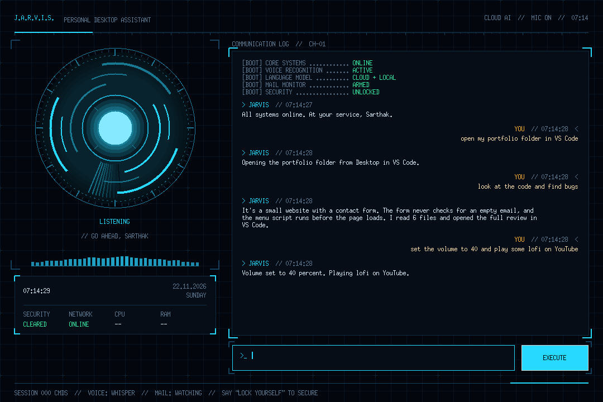
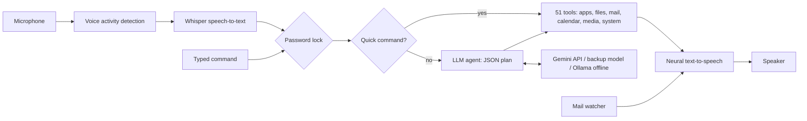

# J.A.R.V.I.S. — LLM-Driven Voice Assistant for Desktop Automation

A voice assistant that controls a Windows laptop the way you would by hand. Say *"Jarvis, open my
portfolio folder in VS Code and find bugs in the code"* or *"summarize today's mail"*, and an LLM agent
plans the steps and carries them out with real tools: apps, files, email, WhatsApp, calendar, YouTube,
volume, camera and more.



<details>
<summary>Start-up animation</summary>


</details>

## Highlights

- **Talk normally.** Whisper speech recognition runs locally; say "Jarvis" once and keep talking for a few
  minutes without repeating it. Background chatter is ignored.
- **51 tools, planned by an LLM agent.** The agent turns a sentence into a short JSON plan of tool calls,
  validated before anything runs. Common commands ("open camera", "volume 40") skip the LLM entirely.
- **Works online and offline.** Gemini API when online, a backup Gemini model when it's busy, and a local
  Ollama model (Qwen2.5-7B) when there's no internet.
- **Fast.** Typical command response cut from **15.7 s to 4.8 s** and the wake reply from **6.2 s to 2.3 s**
  (local speech-to-text, LLM-free quick commands, sentence-by-sentence neural speech).
- **Safe by design.** Password lock (PBKDF2 hash, lockout after wrong tries), deletes go to the Recycle Bin
  only after a spoken "yes", messages are sent only to the person you named, power actions need a typed
  confirmation, and secrets are never read or sent.
- **Tested.** 166 automated tests.

## What it can do

| Area | Examples |
|---|---|
| Apps & windows | "open WhatsApp", "close the camera", "force close Notepad" |
| Files & folders | "open my manga project folder", "create a folder called capstone", "move the essay to that folder", "delete the test folder" |
| Writing | "open Notepad and write an essay on climate change", "read it back" |
| Code | "open my html folder in VS Code", "look at the code and find bugs", "what does app.js do?" |
| Email (Gmail) | "summarize today's mail", "read the mail from Rahul", "reply that I'll join at 6", auto-reply when you're away |
| Messaging | "message Rahul on WhatsApp that I'm on my way" → "send it" |
| Calendar | "schedule a meeting at 3", "what's on my schedule today?" (Google Calendar via iCal) |
| Media | "play the Iron Man theme on YouTube", "most viewed GTA 6 trailer", "pause", "next track" |
| System | "volume up by 20%", "brightness 60", "take a screenshot", "record my screen", "record a video from my camera", "lock the laptop" |

## How it works



| Folder | Purpose |
|---|---|
| `ears/` | Microphone, voice activity detection, Whisper / Vosk speech recognition, wake word |
| `brain/` | LLM providers with fallback (`llm.py`) and the tool-planning agent (`agent.py`) |
| `automation/` | The tools: apps, files, mail (IMAP/SMTP), calendar, camera, code review, password lock |
| `mouth/` | Neural voice (edge-tts) with a phrase cache and an offline fallback voice |
| `desktop_ui.py`, `intro.py` | The HUD window and start-up animation (Tkinter) |
| `tests/` | Automated tests |

## Tech stack

Python · Gemini API · Ollama (Qwen2.5-7B) · faster-whisper · Vosk · edge-tts · Tkinter · Win32 API (ctypes) ·
IMAP/SMTP · iCalendar · OpenCV · psutil

## Setup (Windows 10/11)

1. Install **Python 3.11+** and, for offline mode, **[Ollama](https://ollama.com)** with
   `ollama pull qwen2.5:7b-instruct`.
2. Clone and install:
   ```powershell
   git clone https://github.com/<your-username>/jarvis-assistant.git
   cd jarvis-assistant
   python -m venv .venv
   .\.venv\Scripts\Activate.ps1
   python -m pip install -r requirements.txt
   ```
3. Copy `.env.example` to `.env` and fill in what you need:
   | Setting | What it's for |
   |---|---|
   | `JARVIS_GEMINI_API_KEY` | Online AI (free key from Google AI Studio) |
   | `JARVIS_EMAIL_ADDRESS`, `JARVIS_EMAIL_APP_PASSWORD` | Reading and sending Gmail (use a Google **app password**) |
   | `JARVIS_CALENDAR_ICS_URL` | Your Google Calendar's *secret address in iCal format* |
   | `JARVIS_USER_NAME` | What Jarvis calls you |
4. Optional: copy `contacts.example.json` to `contacts.json` for WhatsApp and email contacts, and set a
   password with `python set_password.py`.
5. Run it:
   ```powershell
   python main.py
   ```
   `python jarvis_check.py` checks your setup if something doesn't work.

The multi-gigabyte Vosk fallback model in `model/` is not included. With the requirements installed,
Jarvis uses faster-whisper by default and downloads its speech model on first run.

Run the tests with `python -m unittest discover tests`.

## Privacy

- `.env` and `contacts.json` stay on your computer and are excluded by `.gitignore`. Only a salted hash of
  the password is stored.
- Speech recognition runs locally. Commands, mail summaries and code you ask about are sent to the Gemini
  API when online, or stay on your laptop with Ollama offline.
- Jarvis never reads `.env` files, keys or files named like passwords, secrets or tokens.

## Limitations

- Windows only (uses Win32 APIs and Windows apps).
- Speech recognition can mishear names; Jarvis double-checks names before sending anything.
- Spotify can open a search but not start a specific song without the paid Web API.
- Camera recording is video only (no sound).

## About

Built by **Sarthak Mishra** as a capstone project at VIT-AP University (B.Tech CSE, AI & ML), 2026.
Licensed under the MIT License.
